# zmk-config

This is my personal [ZMK](https://zmkfirmware.dev/) configuration.

---

## Keyboards

| Keyboard | Config | Workflow | ZMK | Firmware artifact |
|----------|--------|----------|-----|-------------------|
| Urchin | `config/` (`build.yaml`) | `.github/workflows/build.yml` | `main` | `firmware` |
| beekeeb Toucan2 (36-key) | `toucan/` (`toucan/build.yaml`) | `.github/workflows/build-toucan.yml` | `v0.3` | `toucan-firmware` |

Urchin builds `nice_nano//zmk`: ZMK `main` (Zephyr 4.1) renamed `nice_nano_v2`.

Toucan2 builds from its own west manifest because its trackpad driver and
144x168 display shield (from
[beekeeb/zmk-keyboard-toucan2](https://github.com/beekeeb/zmk-keyboard-toucan2))
target ZMK v0.3. Its shield is also named `nice_view_gem`, which would clash with the
one urchin uses.

## Toucan2

`toucan/toucan.keymap` is the urchin layout (`config/urchin.keymap`) on Toucan's
42-position matrix. The 36-key board has no outer pinky column, so those six
positions are unbound and the diagram leaves them out.

### Thumbs

| | Left outer | Left middle | Left inner | Right inner | Right middle | Right outer |
|---|---|---|---|---|---|---|
| Base | left click | Space / hold NUM | hold NAV | — | Bksp (Shift: Del) | left click |
| Finger on the trackpad | left click | middle click | right click | right click | middle click | left click |
| FN | left click | bootloader (left half) | back to base | — | bootloader (right half) | left click |

The outer thumbs are left click on every layer. Tap to click, hold to drag: a
held outer thumb stays pressed while you lift the finger and put it back, so a
drag (a screenshot selection, say) can cover more than one trackpad width.

### Layers

- **LINUX** (base): home-row mods on S D F and J K L (Ctrl, Alt, Meta).
- **Combos** work on every layer (except the MOUSE exit below); the diagram draws
  them in a panel of their own.
- **NAV**: hold the left inner thumb, or press the right inner and middle thumbs
  together to stay in it. From NAV: Q goes back to base, R to MEDIA, T to FN,
  G to NUM, and B leaves NAV.
- **NUM**: hold Space, or NAV then G.
- **MEDIA** and **FN**: reached from NAV; the left inner thumb goes back to base.
- **MOUSE**: on while a finger is on the trackpad (thumbs become mouse buttons).
  If it stays on after you lift the finger (a lost finger-up), press **both
  middle thumbs together** to go back to base; touching and lifting the
  trackpad once also clears it.
- **SYM** is defined, as in the urchin keymap, but no key switches to it.

### Trackpad

| Gesture | Does |
|---|---|
| One-finger tap | left click |
| Two-finger tap | right click |
| Two fingers moving | scroll |
| Pinch | zoom (Ctrl −/=) |
| Finger still for 0.5 s, then move | drag, until the finger lifts (use an outer thumb for longer drags) |
| Three fingers up | Mission Control (⌃↑) |
| Three fingers down | App Exposé (⌃↓) |
| Three fingers left / right | OmniWM focus one column right / left (⌥→ / ⌥←): the columns follow your fingers |
| Moving while NAV is active | scroll |

Each three-finger swipe sends one shortcut, at most one every 1.2 s; the mapping is
`&swipe_button_mapper` at the end of `toucan/toucan.keymap`. The other trackpad
settings come from beekeeb's shield (`toucan_right.overlay`), pinned in
`toucan/west.yml`. Smooth scrolling on the Mac is LinearMouse, in the dotfiles.

### Flashing

Firmware: the `toucan-firmware` artifact of the "Build Toucan2" workflow run.

1. Put the half in its bootloader: switch to FN (hold NAV, tap T) and press that
   half's middle thumb. Without working firmware, double-tap the RST button on
   the XIAO, beside its USB-C port (beekeeb: support the acrylic plate while you
   press). A drive named `XIAO…` mounts.
2. `cp -X <file>.uf2 /Volumes/XIAO*/`. The board restarts as soon as it has the
   file, so Finder's error -36 on a drag-and-drop copy is harmless.
3. A keymap change needs only the left half: the keymap lives there. When both
   halves need firmware, do the right half first; once the left is in its
   bootloader it can't pass the command on.

If the halves stop connecting: flash `settings_reset` to both halves, then their
firmware, then remove "Toucan" from the computer's Bluetooth devices and pair again.

### Diagram

After a keymap change, run `uv run keymap-drawer/draw.py` to regenerate
`keymap-drawer/toucan.svg` (and the parsed `toucan.yaml`). Labels and combo
placement are in `keymap-drawer/config.yaml`.

---

> ZMK Firmware is an open source (MIT) keyboard firmware built on the
> [Zephyr™ Project](https://zephyrproject.org/) Real Time Operating System
> (RTOS). ZMK's goal is to provide a modern, wireless, and powerful firmware
> free of licensing issues.
